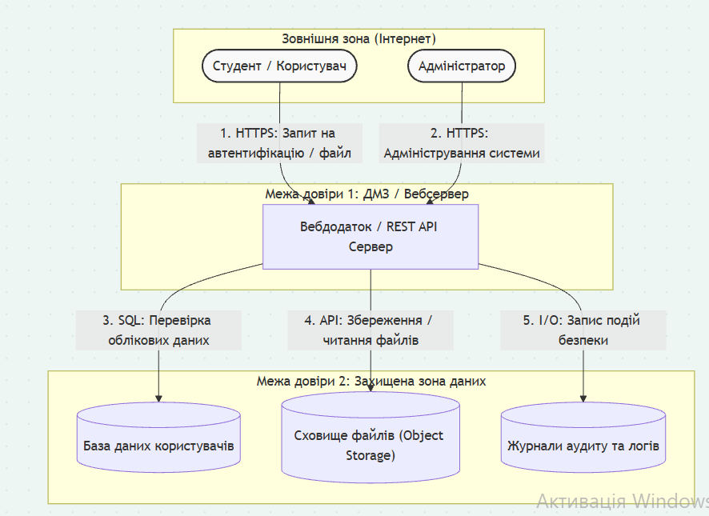

# Модель загроз: СЕРВІС ОБМІНУ ФАЙЛІВ МІЖ СТУДЕНТАМИ

**Варіант:** <N></n>  15·  **Здобувач:** Панасенко Олександр Юрійович  ·  **Група:** ІП-31

## 1. Опис системи та активи

Інформаційна система "UniBoard" призначена для студентів та викладачів ВНЗ задля безпечного завантаження, зберігання, пошуку та спільного використання навчальних матеріалів (як-от конспекти, лабораторні роботи, курсові, методичні посібники та ін.).

**Користувачі:**

* студенти (завантажують та скачують матеріали, коментують);
* викладачі (перевіряють контент, керують доступом);
* адміністратор (технічне обслуговування, записи та ролі)

**Архітектура та зовнішнє з'єднання:** Система складається з веб інтерфейсу, бекенд-сервісу на основі REST API, файлового сховища (Object Storage) та реляційної БД користувачів. Система інтегрована із зовнішньою службою SMTP для надсилання поштових сповіщень та зовнішньою службою автентифікації ВНЗ.

| Актив                                                                                                                                                    | Тип                    | Цінність (К/Ц/Д)                  |
| ------------------------------------------------------------------------------------------------------------------------------------------------------------- | ------------------------- | -------------------------------------------- |
| **База даних облікових записів** (облікові записи, паролі, ролі)                                      | Дані / БД           | Висока / Висока / Висока   |
| **Репозиторій навчальних файлів** (конспекти, лабораторні роботи, звіти практичних) | Дані / Сховище | Середня / Висока / Висока |
| **Журнали аудиту та логування** (Історія дій, IP-адреси, таймстампи)                                  | Дані / Логи       | Низька / Висока / Середня |
| **Вебдодаток та REST API сервер**                                                                                                     | ПЗ                      | Низька / Висока / Висока   |
| **Система коментарів та оцінювання**                                                                                       | Дані/БД             | Низька / Середня / Низька |

## 2. Діаграма потоків даних

<!-- Вставте DFD: зовнішні сутності, процеси, сховища, потоки, межі довіри.
     Джерело діаграми — файл dfd.mmd (Mermaid) або зображення. -->

## 3. Загрози за STRIDE

| №  | Елемент/потік   | Категорія STRIDE | Опис загрози                                                                                                                                                                                                                                        | Порушувана властивість |
| --- | --------------------------- | ------------------------- | -------------------------------------------------------------------------------------------------------------------------------------------------------------------------------------------------------------------------------------------------------------- | ------------------------------------------- |
| 1.  | Студент              | Spoofing                  | Зловмисник перехоплюєдані  студента і видає себе за нього в системі.                                                                                                                           | Authentication                              |
| 2.  | Студент              | Repudation                | Студент заперечує факт завантаження плагіату або шкідливого ПЗ, бо в початковій точці відсутній цифровий ідентифікатор автора                     | Non-repudation                              |
| 3.  | Адмін                  | Repudation                | Адміністратор заперечує факт видалення важливих файлів через відсутність шифрованого логування                                                                            | Non-repudation                              |
| 4.  | 1. Студент-->web app | Information Disclosure    | Перехоплення незашифрованого трафіку при передачі від студента до сервера                                                                                                                     | Confidentiality                             |
| 5.  | 1. Студент-->web app | Tampering                 | Модифікація пакетів даних у потоці за умови відсутності перевірки цілісності                                                                                                                | Integrity                                   |
| 6.  | 1. Адмін-->web app     | DoS                       | Блокування доступу Адміністратора шляхом забруднення потоку запитами                                                                                                                             | Avaliability                                |
| 7.  | Web app                     | Elevation of Privilege    | Звичайний студент експлуатує вразливість веб-додатку для зміни своєї ролі на вищу (адміністратор)                                                                           | Authorization                               |
| 8.  | Web app                     | Information disclosure    | Зловмисник використовує вразливість у Rest API для перегляду і зміни (видалення) приватних файлів і даних студентів                                                 | Confidentiality                             |
| 9.  | Web app                     | Repudation                | Додаток не фіксує незмінні мітки часу, що дає студентам заперечувати факт (або час, що може бути важливо для дедлайнів) подання документів | Non-repudation                              |
| 10. | Web app-->authDB            | Tampering                 | SQL Injections через недостатню захищеність входів                                                                                                                                                                             | Integrity                                   |
| 11. | authDB                      | Information Disclosure    | Прямий зловмисний доступ до БД, персональних даних та паролів                                                                                                                                              | Confidentiality                             |
| 12. | FileStore                   | Tampering                 | Зловмисник модифікує файли, змінюючи їх на (або додаючи до них) вірусне ПЗ                                                                                                                         | Integrity                                   |
| 13. | AuditLog                    | Repudation                | Зловмисник із високими привілеями видаляє або модифікує логи для заперечення своєї діяльності                                                                                | Non-repudation                              |
| 14. | WebApp-->AuditLog           | DoS                       | Зловмисник захаращує пам'ять непотрібними файлами (як-от zip-bomb)), завантажуючи їх через потік                                                                                       | Avaliability                                |

## 4. Оцінювання ризиків (CVSS / матриця)

| № загрози | Вектор CVSS                            | Базова оцінка | Імовірність | Вплив         | Ранг ризику |
| ----------------- | -------------------------------------------- | ------------------------- | ---------------------- | ------------------ | --------------------- |
| 1                 | CVSS:3.1/AV:N/AC:L/PR:N/UI:R/S:U/C:H/I:H/A:N | 8.1                       | Висока           | Високий     | Високий        |
| 2                 | CVSS:3.1/AV:N/AC:L/PR:L/UI:N/S:U/C:N/I:L/A:N | 4.3                       | Середня         | Низький     | Середній      |
| 3                 | CVSS:3.1/AV:N/AC:H/PR:H/UI:N/S:U/C:N/I:L/A:N | 2.2                       | Низька           | Низький     | Низький        |
| 4                 | CVSS:3.1/AV:N/AC:H/PR:N/UI:N/S:U/C:H/I:N/A:N | 5.9                       | середня         | середній   | Середній      |
| 5                 | CVSS:3.1/AV:N/AC:H/PR:L/UI:N/S:U/C:N/I:H/A:N | 5.3                       | Низька           | Високий     | Середній      |
| 6                 | CVSS:3.1/AV:N/AC:L/PR:H/UI:N/S:U/C:N/I:N/A:H | 4.9                       | Низька           | Високий     | Середній      |
| 7                 | CVSS:3.1/AV:N/AC:L/PR:L/UI:N/S:C/C:H/I:H/A:H | 9.9                       | Середня         | Критичний | Критичний    |
| 8                 | CVSS:3.1/AV:N/AC:L/PR:L/UI:N/S:U/C:H/I:H/A:N | 8.1                       | Висока           | Високий     | Високий        |
| 9                 | CVSS:3.1/AV:N/AC:L/PR:L/UI:N/S:U/C:N/I:L/A:N | 4.3                       | Середня         | Низький     | Середній      |
| 10                | CVSS:3.1/AV:N/AC:L/PR:L/UI:N/S:U/C:N/I:H/A:N | 6.5                       | Середня         | Високий     | Середній      |
| 11                | CVSS:3.1/AV:N/AC:L/PR:H/UI:N/S:U/C:H/I:N/A:N | 4.9                       | Низька           | Високий     | Середній      |
| 12                | CVSS:3.1/AV:N/AC:L/PR:L/UI:N/S:U/C:N/I:H/A:N | 6.5                       | Середня         | Високий     | Середній      |
| 13                | CVSS:3.1/AV:N/AC:H/PR:H/UI:N/S:U/C:N/I:H/A:N | 4.4                       | Низька           | Високий     | Середній      |
| 14                | CVSS:3.1/AV:N/AC:L/PR:L/UI:N/S:U/C:N/I:N/A:H | 6.5                       | Середня         | Високий     | Середній      |

## 5. Реєстр ризиків і рішення

| № | Ризик                                                                                                                | Рішення (усунути/зменшити/передати/прийняти) | Контрзахід                                                                                                                                                | Залишковий ризик                |
| -- | ------------------------------------------------------------------------------------------------------------------------- | ---------------------------------------------------------------------------------- | ------------------------------------------------------------------------------------------------------------------------------------------------------------------- | ---------------------------------------------- |
| 1  | Захоплення сесії студента                                                                          | Усунути                                                                     | Використання прапорців безпеки, впровадження захисту від CSRF                                                    | Низький                                 |
| 2  | Відмова від авторства щодо завантаженого файлу                                   | Прийняти або зменшити                                           | Генерація хешу завантаження та прив'язка до унікального ідентифікатора користувача в БД | Низький (майже відсутній) |
| 3  | Відмова адміна від авторства видалення                                                  | Зменшити                                                                   | Логування кожної дії у захищений журнал/сервер                                                                              | Дуже низький                        |
| 4  | Витік даних в транзиті                                                                                 | Усунути                                                                     | Примусове шифрування транспорту (HTTPS)                                                                                                | Низький                                 |
| 5  | Модифікація файлу в пересуванні                                                               | Зменшити                                                                   | Перевірка цілісності пакетів, валідація хеш-суми                                                                          | Низький                                 |
| 6  | DoS атака адміністративного каналу                                                            | Передати                                                                   | Передати обов'язок захисту  зовнішньому провайдеру (як-от Cloudflare)                                              | Низький                                 |
| 7  | Підвищення привілеїв                                                                                   | Усунути                                                                     | Жорстка валідація вхідних даних, заборона автоматичного мапування ролей                              | Низький-середній                |
| 8  | Зловмисний доступ до завантажених файлів (модифікація/видалення) | Усунути                                                                     | Сувора перевірка права доступу для кожного запиту                                                                        |                                                |
| 9  | Відмова від факту виконання операцій                                                      | Прийняти                                                                   | Залишається прийнятим, бо операції мають низький вплив та не вимагають витрат                    | Середній                               |
| 10 | SQL Injection                                                                                                             | Усунути                                                                     | Використовувати Prepared Statements та ORM замість об'єднання рядків                                                         | Низький                                 |
| 11 | Витік даних з БД користувачів                                                                    | Зменшити                                                                   | Надійніше хешування паролів та обмеження доступу мережею.                                                         | Низький                                 |
| 12 | Модифікація файлів сховища, вивантажених користувачами                   | Передати                                                                   | Використання хмарного Об'єктного Сховища із гарантіями безпеки                                               | Низький                                 |
| 13 | Відмова відповідальності через видалення логів                                  | Зменшити                                                                   | Експорт логів в реальному часі на зовнішній сервер із забороною видалення/модифікації     | Низький                                 |
| 14 | Заповнення файлового сховища DoS                                                                | Зменшити                                                                   | Ліміт на розмір файлу та на використання одним юзером                                                                  | Низький, може й відсутній |

## 6. Дерево атак для найкритичнішої загрози

Мета: Отримання адміністративних привілеїв у системі "UniBoard" через експлуатацію вразливостей вебдодатка
OR
├── Експлуатація уразливості Mass Assignment при реєстрації / оновленні профілю
│   AND
│   ├── Віднайти незахищенні endpoint-и API, що приймають об'єкти ролей
│   └── Надіслати модифікований HTTP-запит з додатковим полем "role: admin"
└── Зловживання логікою контролю доступу (Broken Access Control)
    AND
    ├── Проаналізувати структуру викликів API та пошук слабкої валідації на бекенді
    └── Змінити значення ідентифікатора ролі або здійснити прямий виклик адміністративних методів

<!-- Кореневий вузол — мета атаки; кон'юнктивні (AND) та диз'юнктивні (OR) вузли. -->

## 7. Висновки

У ході моделювання загроз було сформовано реєстр із 14 загроз (що задовольняє умові у мінімальні 12). Загрози категорії Repudation (4) перевищують кожну іншу категорію окремо (3), виявлено 3 загрози з параметром небезпеки принаймні 7 (2 високі та 1 критична) - #1, #7 та #8.

Найвищу загрозу становить #7 (CVSS 9.9), що зумовлено зміною області дії (S:C) та максимальним впливом на найцінніший актив системи -- базу даних персональної інформації і ролей. Успішна атака надає зловмиснику можливість отримати права адміністратор, а з цим - абсолютний доступ до системи.

Найкращим контрзаходом з економічної точки зору (через покриття максимального обсягу) є централізована система валідації даних з обов'язковою перевіркою прав доступу. Цей контрзахід дозволить перекрити кілька частин дерева атак: підвищення привілеїв (#7) та зловмисний доступ/модифікацію файлів/даних (#8).

Загрозу #9 можна пропустити найпершою: вона має невеликий вплив на малі операції (незначна відмова), а витрати на її рішення можуть бути необгрунтованими. Загрозу #2 можна в теорії пропустити, якщо додати попередню перевірку файлів на віруси, проте рішення Repudation може бути дешевшим.
